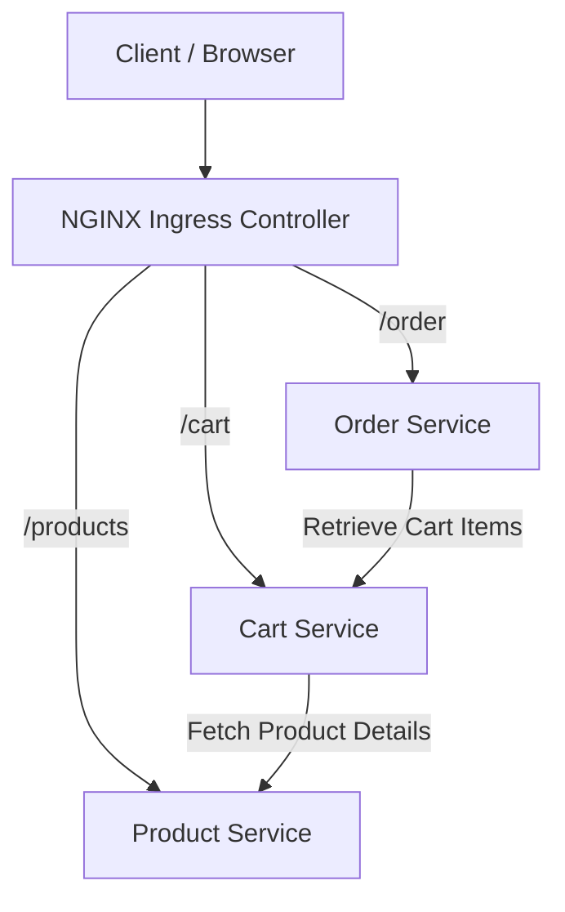

#  E-Commerce Microservices Application

**A Microservices-Based E-Commerce Application Deployed Using Docker, Kubernetes and NGINX Ingress.**

## Project Overview

This project demonstrates the development and deployment of an e-commerce application using a microservices architecture.

The application consists of three independent services developed using Python Flask and deployed locally using Docker and Kubernetes.

## Architecture

### Architecture Explanation

1. Client sends HTTP requests through the browser.
2. NGINX Ingress Controller receives incoming requests.
3. Ingress routes requests to the appropriate microservice.
4. Cart Service communicates with Product Service to retrieve product details.
5. Order Service communicates with Cart Service to retrieve cart items.
6. Kubernetes Services enable internal communication between microservices.

## Technologies Used

- Python
- Flask
- REST APIs
- Docker
- Docker Desktop
- Kubernetes
- kubectl
- NGINX Ingress Controller
- YAML
- Git and GitHub
- PowerShell

##  Microservices

| Service          |         Responsibility        | Port |

| Product Service  | Manages product information   | 5001 |
| Cart Service     | Adds and retrieves cart items | 5002 |
| Order Service    | Creates customer orders       | 5003 |

##  Application Features

- Retrieve product details.
- Add products to the shopping cart.
- Retrieve cart contents.
- Create customer orders.
- Enable communication between microservices.
- Route requests through NGINX Ingress.

##  Project Implementation

### Stage 1: Microservices Development

- Developed three independent Flask applications.
- Created REST API endpoints.
- Tested APIs using PowerShell.

### Stage 2: Docker Containerization

- Created Dockerfiles for all three services.
- Built Docker images.
- Ran application containers.
- Configured Docker networking.

### Stage 3: Kubernetes Deployment

- Enabled Kubernetes in Docker Desktop.
- Created Kubernetes Deployments.
- Deployed three application Pods.
- Created ClusterIP Services.
- Configured service-to-service communication using Kubernetes DNS.

### Stage 4: Ingress Configuration

- Installed NGINX Ingress Controller.
- Created Kubernetes Ingress resources.
- Configured URL-based routing.
- Tested all application routes through a single local entry point.

## API Endpoints

| HTTP Method | Endpoint  |       Description     |

| GET         | /products | Retrieve all products |
| GET         | /cart     | Retrieve cart items   |
| POST        | /cart     | Add a product to cart |
| POST        | /order    | Place an order        |

## Application Access

The application was tested locally through NGINX Ingress.

- Products: `http://localhost:8080/products`
- Cart: `http://localhost:8080/cart`
- Order: `http://localhost:8080/order` (POST request)

## Testing and Results

Successfully verified:

- Product Service returns product information.
- Cart Service adds products successfully.
- Order Service creates orders successfully.
- All three Kubernetes Pods reach Running status.
- Kubernetes Services enable internal communication.
- NGINX Ingress routes requests to the correct services.
- Successfully placed an order through the Ingress endpoint.

## Current Limitations

- Application data is stored in memory and resets when services restart.
- Database integration is not included.
- Application is deployed locally using Docker Desktop Kubernetes.
- This is a learning project and is not a production-ready e-commerce system.

## Key Learnings

- Microservices architecture.
- Docker containerization.
- Kubernetes Deployments and Services.
- Kubernetes service discovery.
- NGINX Ingress configuration.
- YAML configuration.
- REST API testing.
- Git and GitHub version control.

Author-
Pallavi Bai N
GitHub: [pallavi-cloudtech](https://github.com/pallavi-cloudtech)
